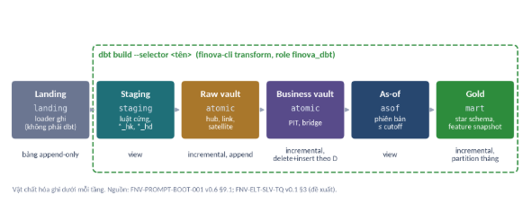

FSS · Hướng dẫn dbt cho DEV Finova

**Hướng dẫn cài đặt và phát triển dbt cho DEV Finova**

FNV-GUIDE-DBT · v1.0 · 09/10/2026 · Tài liệu đào tạo nội bộ

*Bảng 1. Thông tin tài liệu*

|**Mục**|**Nội dung**|
| :- | :- |
|**Mã**|FNV-GUIDE-DBT|
|**Phiên bản**|1\.0 · 09/10/2026|
|**Người đọc**|DEV Finova đã qua bài SQL tuần 1 và bài star schema bằng dbt tuần 2|

**dbt của Finova chạy trên PostgreSQL 16 bằng nhánh dbt 1.x, cài qua uv, đọc mật khẩu từ biến môi trường và chỉ được gọi bằng dbt build.** 
## **Mục lục**
1\. Mục đích và cách dùng tài liệu

2\. Năm nguyên tắc khi dùng dbt ở Finova

3\. dbt trong lakehouse Finova

4\. Cài đặt môi trường DEV

5\. Cấu trúc project, vật chất hóa và package

6\. Quy ước đặt tên và viết code

7\. Lập trình theo tầng

8\. Kiểm thử

9\. Chạy, debug và đọc log

10\. Git, review và CI

11\. Lộ trình đào tạo và bài thực hành

Phụ lục A. Sự cố và lỗi hay gặp · Phụ lục B. Thuật ngữ · Phụ lục C. Nguồn tham chiếu
# **1. Mục đích và cách dùng tài liệu**
Tài liệu trả lời ba câu hỏi: 

1. Cài dbt thế nào trên máy DEV Finova; 
1. Viết model theo quy ước nào; 
1. Kiểm tra và chạy ra sao. 

Người đọc đã viết được SQL nhiều bảng và đã dựng một star schema bằng dbt ở tuần 2, nên tài liệu không giải thích lại SELECT, JOIN hay khái niệm fact, dimension.

Mỗi quy định mang một mã QT-\* gồm tiền tố và tên gợi nhớ, ví dụ QT-NO-NOW (không dùng hàm thời gian trong model).  

*Bảng 2. Mức áp dụng*

|**Mức**|**Nghĩa**|**Khi lệch**|
| :- | :- | :- |
|**MUST**|Bắt buộc. Có cảm biến CI hoặc người review chặn (*ví dụ test không đạt*)|PR không được merge|
|**SHOULD**|Nên làm. Có lý do để lệch trong vài trường hợp|Ghi lý do trong mô tả PR|
|**Gợi ý**|Cách làm thuận tiện, không bắt buộc|Không cần ghi|
# **2. Năm nguyên tắc khi dùng dbt ở Finova**
Năm nguyên tắc dưới đây chi phối các quy định ở những mục sau. Mỗi nguyên tắc xuất phát từ một bất biến của Finova hoặc một lỗi đã gặp ở dự án triển khai Lakehouse – Helios trước kia.

*Bảng 3. Năm nguyên tắc nền*

|**Nguyên tắc**|**Vì sao**|**Chi tiết**|
| :- | :- | :- |
|**Mẫu nạp Data Vault viết thành macro, chạy trên materialization incremental có sẵn của dbt; không tự viết materialization**|Tự viết materialization là tính năng nâng cao của dbt: người sau phải hiểu phần lõi đó mới sửa được một bảng.|Mục 7.3|
|**Mốc thời gian là ingested\_ts mang từ landing; không dùng now() hay giờ chạy dbt**|Chỉ mốc này dựng lại được đúng điều hệ thống biết tại một thời điểm trong quá khứ|Mục 3.3, 7.7|
|**Chỉ chạy bằng dbt build --selector; không dùng dbt run**|Test đỏ thì dbt dừng các model phía sau.|Mục 3.1, 9|
|**Không secret key nào trong git, tài liệu, prompt hay log**|Mật khẩu, DSN chỉ đi qua biến môi trường.|Mục 4.7|
|**Ghim phiên bản dbt-core, dbt-postgres và package**|Không ghim thì pip có thể kéo về bản thử nghiệm dbt-core 2.0.0rc8; |Mục 4.5|

# **3. dbt trong lakehouse Finova**
## **3.1 dbt làm gì**
dbt đảm nhận chữ T (*transform*) trong ELT: dữ liệu đã nằm trong PostgreSQL, dbt biến các câu SELECT thành bảng và view. Mỗi model là một file .sql có Jinja. Khi chạy, dbt làm bốn bước:

1. Dịch Jinja thành SQL thuần (compile), điền đúng database và schema của người chạy.
1. Dựng đồ thị phụ thuộc (DAG) từ các lời gọi ref() và source().
1. Gửi SQL cho PostgreSQL chạy theo thứ tự của DAG. dbt build chạy seed, model, snapshot và test xen kẽ; test của một model đỏ thì mọi node phía sau bị bỏ qua (SKIP).
1. Ghi artifact vào target/: manifest.json (toàn bộ project và DAG), run\_results.json (kết quả lần chạy), catalog.json (khi chạy dbt docs generate).

Ví dụ: tăng sai 100 cổ phiếu ở một dòng số dư, dbt build báo test đối soát lỗi 2 dòng và bỏ qua 5 node phía sau. Với dbt run, 5 node đó vẫn được dựng trên dữ liệu sai.
## **3.2 Các tầng và phần dbt đảm nhận**

*Hình 1. Các tầng lakehouse Finova; khung nét đứt là phần dbt dựng.* 

*Bảng 4. Tầng, schema và physical storerage*

|**Tầng**|**Schema**|**Nội dung**|**Vật chất hóa**|**Role ghi**|
| :- | :- | :- | :- | :- |
|**Landing**|landing, bảng <nguồn>\_<bảng>|Bản ghi nguồn nguyên dạng cùng 5 cột kỹ thuật NOT NULL|Bảng append-only|finova\_loader|
|**Staging**|staging|Luật cứng: ép kiểu có kiểm, chuẩn hóa khóa, giải mã ALLCODE; tính khóa băm và hash\_diff|View, mỗi bảng nguồn một model|finova\_dbt|
|**Raw vault**|atomic|Hub, link, nhl, satellite; chỉ chèn|Incremental append; 9 mẫu nạp T-\*|finova\_dbt|
|**Business vault**|atomic (pit\_, bridge\_)|Con trỏ phiên bản và đường đi phẳng cho ngày D; không chỉ số|Incremental; xóa rồi dựng phần ngày D|finova\_dbt|
|**As-of**|asof|Phiên bản mới nhất có ingested\_ts ≤ cutoff; chưa đặt cutoff thì báo lỗi|View|finova\_dbt tạo view|
|**Gold**|mart|Feature snapshot cho engine; star schema cho giao diện; chỉ số theo registry ngữ nghĩa|Incremental, partition theo tháng|finova\_dbt|
|**Cửa đọc (đề xuất)**|sem\_eng, sem\_api|View chiếu chỉ số cho engine và API; lọc theo môi giới bằng RLS|View, sinh tự động|finova\_dbt tạo; chủ view là role riêng|

Landing không do dbt dựng: loader (*Nifi, Kafka, Debezium, ...*) của finova-cli ghi landing bằng role finova\_loader. dbt chạy dưới role finova\_dbt: profile khai role: finova\_dbt để dbt chạy SET ROLE mỗi khi mở kết nối, nên ma trận quyền vẫn có hiệu lực dù DEV đăng nhập bằng postgres.

Dữ liệu đi một chiều: không đi ngược từ mart về atomic, không nhảy từ landing lên mart. Engine, Dashboard, Open API không có quyền trên staging, atomic và \_truth. 
## **3.3 Hai mốc thời gian**
event\_ts cho biết sự việc xảy ra lúc nào và dùng cho mọi phép tính nghiệp vụ. ingested\_ts cho biết hệ thống biết bản ghi lúc nào. Loader gán cột này một lần ở landing, các tầng sau mang nguyên giá trị. Đây là cột duy nhất dùng để lọc as-of, xếp thứ tự phiên bản và làm điều kiện incremental. Nếu cần ghi giờ dbt ghi bản ghi để quan sát, đặt tên cột dbt\_loaded\_at và không dùng cột này để lọc hay xếp thứ tự. Quy ước kiểm thử: batch 22:00 ngày D nạp dữ liệu ngày D; cutoff của D là 06:00 ngày D+1. Bản ghi của ngày D về muộn lúc 22:00 ngày D+3 mang ingested\_ts của ngày D+3, nên as-of ngày D không thấy nó, đúng như hệ thống thấy hôm đó.

Lọc as-of theo event\_ts là lỗi khó thấy nhất. Trên dữ liệu lịch sử, kết quả kiểm thử đẹp giả tạo vì mọi bản ghi về muộn đều được thấy sớm; lỗi chỉ lộ khi chạy với dữ liệu thật. Cổng G4 (không rò dữ liệu tương lai) và test PT-NOFUTURE tồn tại để bắt lỗi này.
## **3.4 Đặt logic vào tầng nào**
Gặp một phép biến đổi hay công thức mới, trả lời bốn câu theo thứ tự trước khi chọn tầng:

1. Luật cứng (ép kiểu, chuẩn hóa khóa, giải mã)? Viết ở staging; kết quả vào raw vault.
1. Quan hệ hay định danh suy luận mà nhiều nơi dùng chung? Same-as link hoặc link ở Business Vault, kèm mã quy tắc (*được qui định ở tài liệu thiết kế*).
1. Chỉ số, điểm, phân khúc, số tổng hợp? Viết ở Gold và đăng ký trong registry ngữ nghĩa.
1. Chỉ để truy vấn nhanh hơn? PIT hoặc bridge, không chứa giá trị.

Câu trả lời "chỉ số" luôn dẫn tới Gold, không dẫn tới vault. Business Vault trong sách Data Vault 2.0 tính sẵn chỉ số; Business Vault của Finova chỉ giữ con trỏ và đường đi, để mỗi chỉ số có đúng một định nghĩa. So sánh 3NF, Data Vault, Business Vault và star schema có ở phần 1 của deck (slide) đi kèm cùng tài liệu này.
# **4. Cài đặt môi trường DEV**
Cài theo bảy bước dưới đây, trên Windows 11 với PowerShell 7. Trong repo Finova, phần lớn việc cài do run.ps1 setup và run.ps1 db-up đảm nhận; các lệnh thủ công dưới đây dùng cho project lab và để hiểu run.ps1 làm gì.
## **4.1 Yêu cầu phần mềm**
*Bảng 5. Phần mềm trên máy DEV*

|**Thành phần**|**Phiên bản**|**Ghi chú**|
| :- | :- | :- |
|**Windows**|11|Máy DEV chuẩn|
|**PowerShell**|7\.4 trở lên (pwsh)|run.ps1 khai #Requires -Version 7.4|
|**Docker Desktop**|Engine WSL2|Chạy container PostgreSQL 16|
|**Git**|Bản hiện hành|Cần quyền vào repo private Finova|
|**uv**|Bản hiện hành|Quản lý Python, môi trường ảo, lockfile uv.lock|
|**Python**|3\.12, do uv cài|Không dựa vào python trong PATH hay py launcher|
|**PostgreSQL**|16, container finova-pg16-dev|127\.0.0.1:5436; không dùng 5433 (PostgreSQL 13 cũ)|
|**dbt-core, dbt-postgres**|Ghim theo ADR; đề xuất 1.12.5 và 1.11.0|Bảng 6, Bảng 7|
|**VS Code**|Bản hiện hành|Extension ở mục 4.9|

## **4.2 Bước 1: PowerShell và chính sách chạy script**
Nếu PowerShell báo lỗi "Activate.ps1 cannot be loaded", đặt chính sách RemoteSigned cho người dùng hiện tại. Mức này đủ cho script tạo trên máy như Activate.ps1 và chỉ đòi chữ ký với script tải từ Internet. Không dùng Unrestricted, vì mức này cho chạy cả script không ký tải từ Internet. Microsoft cũng ghi rõ execution policy không phải rào chắn an ninh, nên không có lý do mở rộng hơn mức cần.

$PSVersionTable.PSVersion                 # phải từ 7.4

Get-ExecutionPolicy -List                 # chính sách theo phạm vi

Set-ExecutionPolicy -ExecutionPolicy RemoteSigned -Scope CurrentUser
## **4.3 Bước 2: cài uv và Python 3.12**
winget install --id=astral-sh.uv -e

uv --version

uv python install 3.12

uv python list                            # kiểm 3.12 đã có

Không cần thêm Python vào PATH. uv tìm đúng bản Python theo .python-version của repo, nên máy có nhiều bản Python (máy DEV đo ngày 28/09/2026 có Python 3.12 trong PATH và py launcher mặc định 3.13) vẫn chạy đúng bản.
## **4.4 Bước 3: lấy mã nguồn**
git clone <URL repo Finova>               # xin quyền repo trước

cd finova

git switch -c feat/<spec>-<tsk>-<ten-ngan>

`                                        `# ví dụ feat/lak-tskl05-first-seen

Không clone từ repo cá nhân. main được bảo vệ: chỉ merge qua PR khi CI xanh, cấm push thẳng và force push. Với bài lab, giải nén finova\_dbt\_lab.zip vào một thư mục làm việc riêng.

***Nguồn:** Repo tham khảo kèm theo*
## **4.5 Bước 4: cài dbt**
**Trong repo Finova.** Chạy .\run.ps1 setup. Lệnh này chạy uv sync để cài đúng các gói ghim trong uv.lock và cài pre-commit hook. Không cài dbt bằng tay vào môi trường của repo.

**Với project lab, ngoài repo.** 

cd D:\Projects\dbt-lab\finova\_dbt\_lab

uv venv --python 3.12

.venv\Scripts\activate

uv pip install "dbt-core==1.12.5" "dbt-postgres==1.11.0"

dbt --version

Kết quả dbt --version phải ghi Core: installed: 1.12.5 và Plugins: postgres: 1.11.0. Nếu đúng hai dòng này, môi trường đã cài đúng cặp.

*Bảng 6. Cặp phiên bản dbt đã chạy thử với project lab*

|**dbt-core**|**dbt-postgres**|**Python hỗ trợ**|**Trạng thái hỗ trợ của dbt**|**Kết quả lab**|
| :- | :- | :- | :- | :- |
|**1.12.5 (15/09/2026)**|1\.11.0 (16/07/2026)|3\.10–3.14|Đang hỗ trợ tới 15/07/2027|PASS 122, WARN 2; 35 cảnh báo cú pháp arguments:|
|**1.8.10**|1\.8.2|dbt-core từ 3.9; tài liệu dbt ghi 1.8 chạy trên 3.12|Deprecated; dbt in cảnh báo khi chạy|PASS 122, WARN 2 (bản dùng ở tuần 2)|

*Bảng 7. Trạng thái các nhánh dbt ngày 08/10/2026*

|**Nhánh, gói**|**Bản, mốc**|**Trạng thái**|**Hệ quả cho Finova**|
| :- | :- | :- | :- |
|**dbt-core 1.8**|1\.8.10 (bản lab tuần 2)|Deprecated; dbt tự in cảnh báo khi chạy|Không chọn cho repo|
|**dbt-core 1.11**|1\.11.15 (08/09/2026)|Chỉ vá lỗi nghiêm trọng tới 18/12/2026|Không chọn: hết hỗ trợ ngày 18/12/2026|
|**dbt-core 1.12**|1\.12.5 (15/09/2026)|Đang hỗ trợ tới 15/07/2027|Đề xuất ghim, cần ADR|
|**dbt 2.0 (Fusion)**|GA 14/09/2026; phát hành dưới tên gói dbt và dbt-oss|Chưa có adapter PostgreSQL; gói dbt-core 2.0 mới có bản thử nghiệm 2.0.0rc8|Không nâng lên v2|
|**dbt-postgres 1.11.0**|16/07/2026|Khai dbt-core>=1.8.0rc1,<2.0|Ghim gói này chặn được việc pip kéo dbt-core 2.x|

Lab chạy trên Python 3.11.15. Python 3.12 nằm trong dải hỗ trợ của cả hai cặp theo PyPI và bảng tương thích của dbt, nhưng chưa chạy thử trên máy DEV Finova. Cặp 1.12.5 và 1.11.0 là đề xuất: FNV-ARCH-V01 chỉ ghi dbt-core 1.8+, và chọn bản ghim là quyết định kiến trúc cần ghi thành ADR.

**QT-PIN-DBT (MUST).** Luôn ghim cả dbt-core lẫn dbt-postgres. Kiểm bằng pip install --dry-run ngày 08/10/2026 cho ba kết quả. Lệnh pip install dbt-postgres==1.8.2 kéo về dbt-core 2.0.0rc8, vì gói này chỉ khai dbt-core>=1.8.0a1 nên pip được phép chọn bản thử nghiệm. Lệnh pip install dbt cài dbt v2, bản chưa hỗ trợ PostgreSQL. Lệnh pip install dbt-postgres không ghim cho ra 1.12.5 và 1.11.0 hôm nay, nhưng kết quả sẽ đổi theo ngày cài. Môi trường dựng bài tuần 2 từng cài nhầm dbt-core 2.0.0rc8 theo đúng cách này.
## **4.6 Bước 5: PostgreSQL DEV và dữ liệu**
Trong repo, .\run.ps1 db-up bật container finova-pg16-dev và .\run.ps1 migrate tạo database của tenant, schema, role và quyền. Mật khẩu của postgres lấy từ biến FINOVA\_PG\_PASSWORD trong .env; run.ps1 đọc .env và báo tên biến còn thiếu. Container chỉ nghe 127.0.0.1, encoding UTF8, timezone = 'Asia/Ho\_Chi\_Minh'. Tên database là mã tenant đổi - thành \_, ví dụ tenant test-scn có database test\_scn.

Với project lab, nạp dữ liệu tập vào database test\_scn:

$env:PGCLIENTENCODING = 'UTF8'   # psql trên Windows mặc định WIN1252

psql -h 127.0.0.1 -p 5436 -U postgres -d test\_scn -v ON\_ERROR\_STOP=1 `

`     `-f data/w2\_raw\_luyen\_tap\_w2.sql

Đặt PGCLIENTENCODING vì psql trên Windows dùng bảng mã WIN1252 và làm hỏng chú thích tiếng Việt; lần chạy thử của BOOT-001 gặp lỗi character with byte sequence 0x81 in encoding "WIN1252" has no equivalent in encoding "UTF8". Script trong repo thêm \encoding UTF8 ở đầu file với cùng mục đích.
## **4.7 Bước 6: profiles.yml**
profiles.yml chứa thông tin kết nối. Không ghi mật khẩu thẳng vào file và không để file có mật khẩu trong thư mục dự án, vì mật khẩu sẽ dễ lọt vào git. Finova đọc mật khẩu từ biến môi trường:

finova\_dbt\_lab:

`  `target: dev

`  `outputs:

`    `dev:

`      `type: postgres

`      `host: 127.0.0.1

`      `port: 5436

`      `user: postgres

`      `password: "{{ env\_var('FINOVA\_PG\_PASSWORD') }}"

`      `dbname: "{{ env\_var('LAB\_DBNAME', 'test\_scn') }}"

`      `schema: "{{ env\_var('LAB\_SCHEMA', 'hv00') }}"

`      `threads: 4

`      `# trong repo Finova thêm: role: finova\_dbt

Mỗi học viên đặt LAB\_SCHEMA riêng, từ hv01 tới hv06, để không dựng đè schema của nhau. dbt tìm profiles.yml theo thứ tự: cờ --profiles-dir; biến DBT\_PROFILES\_DIR (từ 1.11 có thêm tên mới DBT\_ENGINE\_PROFILES\_DIR, ưu tiên hơn); thư mục đang đứng; cuối cùng ~/.dbt/. Lệnh dbt debug --config-dir in thư mục dbt đang dùng. Nên để profiles.yml ở ~/.dbt/ hoặc thư mục trỏ bằng DBT\_PROFILES\_DIR; nếu đặt trong thư mục dự án thì phải có trong .gitignore.

Biến đặt tên bắt đầu bằng DBT\_ENV\_SECRET được dbt thay bằng \*\*\*\*\* trong log, nhưng chỉ dùng được trong profiles.yml và packages.yml. Tên biến của Finova theo .env.example, nên giữ FINOVA\_PG\_PASSWORD và không in giá trị ra log.
## **4.8 Bước 7: kiểm tra**
dbt debug        # phải kết thúc bằng: All checks passed!

dbt deps         # cài package trong packages.yml (lab không có)

dbt parse        # kiểm cú pháp project, không cần kết nối database

\# lần đầu trên schema mới: PASS 120, WARN 2

dbt build --selector lab\_all --exclude-resource-type unit\_test

\# từ lần thứ hai: PASS 122, WARN 2

dbt build --selector lab\_all

Selector lab\_all chạy 124 node: 2 seed, 31 model (10 view, 11 table, 10 incremental), 89 data test và 2 unit test. Lần đầu trên schema mới phải bỏ unit test: unit test có input this (bảng đích của model incremental) cần bảng đó đã tồn tại để lấy kiểu cột. Hai WARN là có chủ đích: hai khóa LTA099 và XYZ chỉ xuất hiện trong giao dịch nên chưa có satellite. Project lab không dùng package nên dbt deps chỉ báo không có gì để cài; project có packages.yml thì dbt deps sinh package-lock.yml (từ dbt 1.7), và file này nên commit cùng packages.yml để mọi người cài cùng bản.
## **4.9 VS Code và công cụ kiểm code**
*Bảng 8. Extension và công cụ*

|**Công cụ**|**Dùng cho**|**Lưu ý**|
| :- | :- | :- |
|**Python (Microsoft)**|Chọn interpreter .venv để terminal và extension dùng đúng dbt|Chọn lại sau mỗi lần tạo .venv mới|
|**Power User for dbt (innoverio.vscode-dbt-power-user)**|Đi tới định nghĩa ref(), xem SQL đã compile, xem lineage|Chế độ tích hợp mặc định core, chạy với dbt-core; còn được cập nhật (bản 0.64.7, 29/09/2026)|
|**dbt (dbtLabsInc.dbt) của dbt Labs**|Language server, lint|Language server đi kèm dbt v2; chưa xác minh dùng được với project PostgreSQL, nên không dùng mặc định|
|**SQLFluff + sqlfluff-templater-dbt**|Lint SQL theo quy ước, hiểu Jinja của dbt|Bản 4.4.0 (02/10/2026). Repo Finova chạy sqlfluff lint sau mỗi lần sửa file .sql trong finova-dbt/|

Cấu hình SQLFluff tối thiểu đặt trong file .sqlfluff ở thư mục dbt:

[sqlfluff]

templater = dbt

dialect = postgres

encoding = utf-8

[sqlfluff:templater:dbt]

project\_dir = .
# **5. Cấu trúc project, physical storage và package**
Project dbt của Finova nằm ở thư mục finova-dbt/ trong repo. Thư mục con chia theo tầng, rồi theo nguồn hoặc miền, để cấu hình theo thư mục và selector chọn đúng phần cần chạy.

finova-dbt/

`  `dbt\_project.yml  selectors.yml  packages.yml

`  `package-lock.yml  .sqlfluff

`  `semantic/               registry chỉ số, feature (YAML)    [SEM]

`  `models/

`    `staging/<nguồn>/      stg\_<nguồn>\_\_<bảng>.sql, \_<nguồn>\_\_sources.yml

`    `atomic/raw/<miền>/    hub\_\*, link\_\*, nhl\_\*, sat\_\*, lsat\_\*,

`                          `esat\_\*, sts\_\*, ref\_\*

`    `atomic/bv/            pit\_\*, bridge\_\*

`    `asof/                 một view cho mỗi bảng raw vault

`    `gold/base/            fact\_\*, dim\_\*\_daily, met\_account\_daily [SEM]

`    `gold/\_generated/      rollup, feature, mart\_feature\_daily  [SEM]

`    `sem/eng/  sem/api/    view cửa đọc, sinh tự động         [SEM]

`  `macros/dv/              dv\_hash và một macro cho mỗi mẫu nạp T-\*

`  `macros/gold/  macros/sem/                                   [SEM]

`  `tests/slv/<miền>/       singular test, test case

`  `seeds/  snapshots/  analyses/

`  `target/  logs/  dbt\_packages/   # sinh ra khi chạy, không commit

Phần Silver gồm staging, atomic, asof . Phần Gold có registry ngữ nghĩa. Project lab chia đơn giản hơn: models/marts/gold\_dv/ là Gold dựng từ vault, models/marts/star\_w2/ là star schema tuần 2 giữ lại để đối chiếu.

*Bảng 9. Tệp cấu hình của project*

|**Tệp**|**Chứa**|**Vào git**|
| :- | :- | :- |
|**dbt\_project.yml**|Tên project, đường dẫn thư mục, vars, cấu hình theo thư mục (+schema, +materialized, +tags)|Có|
|**selectors.yml**|Selector theo tầng và miền; finova-cli transform --selector chọn theo tên|Có|
|**packages.yml, package-lock.yml**|Package ngoài, ghim phiên bản; file lock sinh bởi dbt deps|Có|
|**profiles.yml**|Kết nối database; mật khẩu qua env\_var()|Không|
|**.sqlfluff**|Quy tắc lint SQL|Có|
|**target/, logs/, dbt\_packages/**|SQL đã compile, artifact, log, package đã tải|Không|

Cấu hình đặt theo thư mục trong dbt\_project.yml, để model mới đặt đúng chỗ là tự có đủ cấu hình. Ví dụ của lab: model mới đặt vào atomic/raw tự có incremental, chiến lược append, on\_schema\_change: fail và tag dv\_raw.

models:

`  `finova\_dbt\_lab:

`    `staging:

`      `+schema: staging

`      `+materialized: view

`    `atomic:

`      `+schema: atomic

`      `raw:

`        `+materialized: incremental

`        `+incremental\_strategy: append

`        `+on\_schema\_change: fail   # nguồn đổi cột thì dừng (LH-14)

`        `+tags: ["dv\_raw"]

Tag của lab đi theo tầng: dv\_raw, dv\_bv, asof, gold\_dv. Repo Finova gắn hai tag cho mỗi model Silver: tag miền (slv\_kh, slv\_gd…) và tag loại bảng (dv\_hub, dv\_link, dv\_sat, dv\_bv); selectors.yml có slv\_<miền> và slv\_all. Gold thêm gold\_day, rls và selector gold\_base, gold\_gen, sem\_views, gold\_all .
## **5.1 Tên schema theo môi trường**
Mặc định dbt đặt model có +schema: staging vào schema <schema của target>\_staging, ví dụ hv01\_staging. Ở DEV cách đặt tên này phù hợp, vì mỗi người một schema. Ở môi trường chạy thật, Finova cần đúng tên staging, atomic, asof, mart để ma trận quyền áp đúng. Macro generate\_schema\_name ghi đè hành vi mặc định theo tên target:



`    `

`    `

`        `{{ default\_schema }}

`    `

`        `{{ custom\_schema\_name | trim }}

`    `

`        `{{ default\_schema }}\_{{ custom\_schema\_name | trim }}

`    `



Tên target dùng cho môi trường chạy thật chốt ở spec triển khai; prod trong ví dụ là giả định của project lab.
## **5.2 Chọn physical storage**
Chọn cách lưu trữ theo chi phí dựng và tần suất đọc. Quy tắc của dbt Labs: bắt đầu bằng view; đọc chậm thì đổi sang table; dựng chậm thì đổi sang incremental.

*Bảng 10. Năm kiểu vật chất hóa*

|**Kiểu**|**Cơ chế**|**Dùng khi**|**Tránh khi**|**Ở Finova, lab**|
| :- | :- | :- | :- | :- |
|**view**|Lưu câu SELECT, chạy lúc đọc|Logic nhẹ, cần luôn mới|Đọc nhiều, join nặng|staging, asof, cửa đọc sem\_\*|
|**table**|Dựng lại toàn bộ mỗi lần chạy|Bảng vừa, đọc nhiều|Dữ liệu lớn, dựng lâu|Gold của lab|
|**incremental**|Chỉ xử lý phần mới rồi ghép vào bảng đã có|Bảng lớn, chủ yếu thêm dòng|Logic phải nhìn lại toàn bộ dữ liệu|Raw vault, PIT, bridge, Gold của Finova|
|**ephemeral**|Gộp thành CTE trong model dùng nó|Bước nhỏ dùng một, hai lần|Cần debug, cần contract|Không dùng|
|**materialized\_view**|View lưu kết quả; PostgreSQL không tự làm mới|Đọc nhiều, nguồn ít đổi|Cần làm mới theo lịch riêng|Không dùng|

Lab có 10 view, 11 table và 10 incremental, đếm từ log dbt build --selector lab\_all. Gold của Finova là incremental, partition theo tháng, vì feature snapshot thêm một ngày mỗi lần chạy. Finova không dùng ephemeral: model ephemeral không truy vấn trực tiếp được và không khai contract được, nên khó kiểm khi lỗi; bước trung gian viết thành CTE trong model.
## **5.3 Incremental: chiến lược và khung model**
is\_incremental() trả về đúng khi cả ba điều kiện thỏa: bảng đích đã có, model khai materialized='incremental', và lần chạy không có --full-refresh. Chiến lược nạp quyết định phần mới được chèn thêm hay thay phần cũ:

*Bảng 11. Chiến lược incremental trên dbt-postgres*

|**Chiến lược**|**Cơ chế**|**unique\_key**|**Dùng ở**|
| :- | :- | :- | :- |
|**append**|Chèn mọi dòng của lô|Không|Raw vault (chỉ chèn); bảng dựng theo ngày D theo spec, kèm pre\_hook xóa ngày D|
|**delete+insert**|Xóa ở bảng đích các khóa có trong lô mới, rồi chèn lô|Có|PIT, bridge, fact của lab|
|**merge**|Câu MERGE INTO: sửa dòng trùng khóa, chèn dòng mới. PostgreSQL có MERGE từ bản 15|Có|Không dùng: vault cấm sửa dòng|
|**microbatch**|Chia lô theo event\_time (từ dbt 1.9); trên dbt-postgres chạy bằng merge|Bắt buộc|Chưa dùng|

Khung model incremental đọc theo cửa sổ ingested\_ts. Lab lấy mốc dưới là ingested\_ts lớn nhất đã có trong bảng; ở Finova, finova-cli truyền cả hai mốc lo\_ts, hi\_ts:

{{ config(materialized='incremental',

`          `incremental\_strategy='append',

`          `on\_schema\_change='fail') }}

select ...

from {{ ref('stg\_luyen\_tap\_\_customers') }}

where ingested\_ts <= '{{ var("hi\_ts") }}'



`  `and ingested\_ts > (select max(ingested\_ts) from {{ this }})



on\_schema\_change có bốn giá trị: ignore (mặc định), fail, append\_new\_columns, sync\_all\_columns. Finova chọn fail: nguồn đổi cột thì build phải dừng, không tự thích nghi trong im lặng.
## **5.4 Package**
Có package Data Vault dùng được với PostgreSQL, nhưng Finova tự viết macro vì quy ước thời gian và khóa riêng. Bảng dưới tra trên GitHub ngày 08/10/2026:

*Bảng 12. Package liên quan và chỗ lệch quy ước Finova*

|**Package**|**Bản mới nhất**|**Có gì cho PostgreSQL**|**Lệch quy ước Finova**|
| :- | :- | :- | :- |
|**AutomateDV**|0\.11.5 (02/2026)|hub, link, sat, eff\_sat, pit, bridge…|Tên cột mặc định load\_datetime; Finova dùng ingested\_ts|
|**datavault4dbt**|2\.1.1 (01/10/2026)|Có; bản mở không có macro bridge|Cửa sổ nạp (lo, hi] và 9 mẫu T-\* riêng|
|**dbt\_utils**|1\.4.1 (28/06/2026)|date\_spine, star, pivot…|generate\_surrogate\_key dùng MD5; Finova sẽ yêu cầu SHA-256 bytea|

- Dùng package để học mẫu hub, link, satellite, PIT đã được nhiều nhóm kiểm; để đối chiếu kết quả macro tự viết trên cùng dữ liệu; và để lấy macro tiện ích không đụng quy ước, như date\_spine.
- Không dùng package để sinh khóa băm, hash\_diff hay cột thời gian của vault; không thay mẫu nạp đã qua các phép kiểm thử; không kéo phụ thuộc mà không ghim bản trong packages.yml.

Đổi quy ước khóa hay cột thời gian sau khi đã nạp đồng nghĩa với nạp lại toàn bộ vault. Vì vậy quy ước phải nằm trong macro của chính repo.
# **6. Quy ước đặt tên và viết code**
Finova theo phần lớn hướng dẫn phong cách của dbt Labs, trừ ba chỗ lệch có lý do: khóa băm kiểu bytea thay vì chuỗi, cột thời gian hậu tố \_ts thay vì \_at, tên model số ít theo tên bảng đích thay vì số nhiều. Ba chỗ lệch giữ cho tên trong code trùng tên trong spec và từ điển dữ liệu.

*Bảng 13. Quy ước đặt tên và viết code*

|**Mã**|**Quy định**|**Mức**|
| :- | :- | :- |
|**QT-TEN-SNAKE**|Tên model, cột, macro, biến bằng tiếng Anh, chữ thường, snake\_case. Comment tiếng Việt cho logic nghiệp vụ|MUST|
|**QT-TEN-STG**|stg\_<nguồn>\_\_<bảng nguồn>, mỗi bảng nguồn một model; nguồn là flex, fiin, finova\_app, manual|MUST|
|**QT-TEN-DV**|hub\_<thực thể>, link\_<a>\_<b>, nhl\_<sự kiện>, sat\_<thực thể>\_\_<nguồn>, lsat\_, esat\_, sts\_, ref\_, pit\_<thực thể>\_daily, bridge\_<đường đi>, sal\_|MUST|
|**QT-TEN-MART**|dim\_, fact\_, mart\_; bảng chỉ số met\_ (đề xuất SEM)|MUST|
|**QT-TEN-YML**|\_<thư mục>\_\_models.yml, \_<thư mục>\_\_sources.yml|SHOULD|
|**QT-TEN-TS**|Thời điểm hệ thống biết: ingested\_ts; sự kiện: event\_ts; ngày nghiệp vụ: business\_date, trade\_date. Không cột load\_dts|MUST|
|**QT-HEADER**|Đầu file 2–4 dòng comment: mục đích, grain, mã spec. Người sửa, ngày sửa xem bằng git|SHOULD|
|**QT-CTE**|CTE import ở đầu file, mỗi CTE một việc, dòng cuối select \* from <CTE cuối>|SHOULD|
|**QT-SQL-STYLE**|Chữ thường, thụt 4 dấu cách, dấu phẩy cuối dòng, as tường minh, ghi rõ loại join|SHOULD|
|**QT-REF**|Phụ thuộc chỉ qua ref(), source(); không viết cứng schema.table|MUST|
|**QT-NO-NOW**|Không now(), current\_timestamp, current\_date, giờ chạy dbt cho mốc hiệu lực hay điều kiện incremental|MUST|
|**QT-TZ**|Đổi timestamptz sang ngày bằng (ts at time zone 'Asia/Ho\_Chi\_Minh')::date tường minh|MUST|
|**QT-HASH**|Khóa băm và hash\_diff SHA-256 kiểu bytea qua macro; định dạng ngày, giờ, bytea tường minh trước khi băm|MUST|
|**QT-THRESHOLD**|Ngưỡng nghiệp vụ ở customers/<tenant>/thresholds.yaml, vào dbt qua vars|MUST|
|**QT-NO-METRIC-VAULT**|Không tính chỉ số (NAV, tỷ lệ ký quỹ…) trong vault. Chỉ số ở Gold và có mục trong registry ngữ nghĩa|MUST|
|**QT-NO-EPHEMERAL**|Không dùng materialization ephemeral; bước trung gian viết thành CTE trong model|SHOULD|
|**QT-DAY-REBUILD**|Bảng dựng theo ngày D xóa phần ngày D bằng macro pre\_hook dùng chung rồi chèn; không chép câu delete vào từng model|SHOULD|
|**QT-SECRET-ENV**|Mật khẩu, DSN chỉ qua biến môi trường|MUST|
|**QT-PIN-DBT**|Ghim phiên bản dbt-core, dbt-postgres và package|MUST|
|**QT-MONEY**|Tiền, giá, khối lượng dùng numeric, không dùng float|MUST|

## **6.1 Header của model**
Header ghi phần git không giữ: mục đích, grain và mã spec. Người tạo, người sửa và ngày sửa không ghi vào header, vì git đã giữ các thông tin này và header viết tay sẽ lệch với lịch sử thật sau vài lần sửa.

-- Satellite thuộc tính khách hàng từ nguồn luyen\_tap (mẫu nạp T-SAT)

-- Grain: 1 dòng = 1 phiên bản (customer\_hk, ingested\_ts)

-- Spec: FNV-ELT-SLV-KH, đối chiếu sat\_customer\_profile\_\_flex

Grain viết lại trong description của file yml, bắt đầu bằng "Grain: 1 dòng = …", để dbt docs hiển thị và test grain dựa vào đó.
# **7. Lập trình theo tầng**
Ví dụ trong mục này lấy từ project finova\_dbt\_lab và đã chạy trên dữ liệu luyen\_tap\_w2. Dữ liệu tập không có loader, nên ingested\_ts là giả lập theo quy tắc có thể chạy lại của hệ thống Lakehouse. Ở Finova, dữ liệu mang ingested\_ts giả lập (*kịch bản số liệu để kiểm tra*) phải được đánh dấu ở ctrl.source\_system.
## **7.1 Khai báo source**
Mỗi nguồn một file \_<nguồn>\_\_sources.yml, khai bảng và mô tả. Khi có landing, source trỏ schema landing và khai freshness để biết nguồn có về đúng hạn không.

version: 2

sources:

`  `- name: luyen\_tap

`    `schema: luyen\_tap\_w2

`    `tables:

`      `- name: customers

`        `description: >

`          `Mỗi dòng là một phiên bản của khách, mốc là updated\_at;

`          `có dòng trùng hoàn toàn.

`      `- name: orders

`        `description: Lệnh đặt; order\_ts là timestamptz.
## **7.2 Staging**
Staging là view, mỗi bảng nguồn một model. Staging chỉ làm luật cứng: ép kiểu có kiểm, trim và upper khóa, giải mã ALLCODE, tách dòng bị loại sang view \_\_rejected kèm lý do. Luật mềm như phân loại giao dịch, quy đổi, định giá hay gộp định danh không được vào staging. Qui tắc thiết kế cho phép thêm view dẫn xuất ở staging trong đúng hai trường hợp: hợp nhất cặp bảng hiện hành – lịch sử, và tách một bảng mang nhiều grain. Hai loại view này vẫn chỉ chứa luật cứng. Staging không lọc theo ngày: cửa sổ nạp đặt ở model vault.

with src as (

`    `select distinct

`        `upper(trim(customer\_id)) as customer\_id,

`        `upper(trim(segment))     as segment,

`        `upper(trim(kyc\_status))  as kyc\_status,

`        `updated\_at

`    `from {{ source('luyen\_tap', 'customers') }}

)

select

`    `customer\_id, segment, kyc\_status, updated\_at,

`    `{{ dv\_hk(['customer\_id']) }}              as customer\_hk,

`    `{{ hash\_key(['segment', 'kyc\_status']) }}

`        `as sat\_customer\_\_luyen\_tap\_hd,

`    `{{ replay\_ingested\_ts('updated\_at') }}    as ingested\_ts,

`    `'luyen\_tap.customers'::text               as record\_source

from src

Đọc từng phần: CTE src lấy cột từ nguồn và chuẩn hóa khóa; dv\_hk băm khóa nghiệp vụ kèm mã hệ thống (bkcc); hash\_key băm các cột thuộc tính để biết phiên bản có đổi không; replay\_ingested\_ts gán mốc giả lập, ở Finova thật cột này mang nguyên từ landing. Staging tính sẵn khóa băm \*\_hk và hash\_diff \*\_hd cho từng satellite, nên hub, link, satellite nạp song song được mà không bảng nào phải tra bảng khác để lấy khóa. Khóa của link băm từ khóa nghiệp vụ, không băm lại từ khóa của hub.

**Bẫy khi băm.** Không băm date::text, timestamptz::text hay bytea::text: kết quả đổi theo DateStyle, TimeZone và bytea\_output của phiên, nên cùng một dòng chạy từ hai máy cho hai hash\_diff . Lab định dạng tường minh bằng fmt\_date(), fmt\_ts(), fmt\_hk() trước khi băm. Macro dv\_hash của Finova định dạng timestamptz theo UTC dạng ISO 8601, date dạng 'YYYY-MM-DD', boolean dạng 'true'/'false'.
## **7.3 Raw vault**
Mỗi loại bảng có một phương pháp (*mẫu - pattern*) nạp, viết một lần thành macro; model chỉ khai báo cột. Lợi ích cụ thể trong bài tập 42 bảng của Silver (satellite, lsat, esat, ref) dùng chung mẫu T-SAT, nên sửa và kiểm một macro là áp cho tất cả.

-- models/atomic/raw/hub\_account.sql

-- nhận khóa từ mọi staging mang khóa tiểu khoản

{{ dv\_hub(hk='account\_hk', bk='account\_id',

`          `sources=['stg\_luyen\_tap\_\_accounts',

`                   `'stg\_luyen\_tap\_\_orders',

`                   `'stg\_luyen\_tap\_\_cash\_txn']) }}

-- models/atomic/raw/sat\_customer\_\_luyen\_tap.sql

{{ dv\_sat(parent\_hk='customer\_hk', hd='sat\_customer\_\_luyen\_tap\_hd',

`          `attrs=['segment', 'kyc\_status'],

`          `source='stg\_luyen\_tap\_\_customers') }}

Hub nhận khóa từ mọi staging mang khóa, không chỉ từ nguồn làm chủ khái niệm. Nhờ vậy link không bao giờ trỏ tới khóa vắng mặt (*orphan – mô côi*) trong hub, và khóa bẩn không bị loại trong im lặng:

*Bảng 14. Hub của lab và nguồn mang khóa*

|**Hub**|**Nguồn mang khóa**|**Dòng**|**Chưa có satellite**|
| :- | :- | :- | :- |
|**hub\_customer**|customers, accounts|30|0|
|**hub\_account**|accounts, orders, cash\_txn|41|1 (LTA099, chỉ có ở giao dịch tiền)|
|**hub\_instrument**|instruments, orders|32|1 (XYZ, chỉ có ở lệnh)|

Test dv\_has\_master\_satellite mức warn đếm khóa chưa có satellite của nguồn làm chủ, nên dbt build báo PASS kèm WARN 2 là có chủ đích. Star schema tuần 2 giữ tổng nhờ dòng "không xác định" ở dimension; vault giữ khóa ngay từ hub, Gold quyết định cách trình bày.

Macro dv\_sat theo mẫu T-SAT làm bốn bước:

1. Lấy dòng staging trong cửa sổ nạp: ingested\_ts > lo và ≤ hi. Lab mặc định lấy lo là ingested\_ts lớn nhất đã có trong bảng. Ở Finova, finova-cli truyền lo, hi lấy từ sổ chạy ctrl, và T-GUARD dừng build trước model vault khi có lô về lệch thứ tự.
1. Bỏ dòng trùng nguyên nội dung cùng thời điểm (distinct on).
1. Tìm phiên bản mới nhất đã có trong vault của các khóa trong cửa sổ (chỉ khi is\_incremental()).
1. Chỉ chèn dòng có hash\_diff khác phiên bản liền trước: dòng đầu cửa sổ so với phiên bản mới nhất trong vault, các dòng sau so với dòng liền trước (lag).

Ví dụ khách LTC008: nguồn có ba dòng VIP ngày 03/03, AFFLUENT ngày 11/03, VIP ngày 20/03. Satellite giữ đủ ba phiên bản lúc 22:00 của ba ngày đó. VIP xuất hiện hai lần vẫn là hai phiên bản, vì quy tắc so với phiên bản liền trước, không so với mọi bản cũ (INV-T3). Gom bằng select distinct customer\_id, segment sẽ chỉ còn hai dòng và sai khoảng hiệu lực.

*Bảng 15. Kết quả nạp raw vault trong lab*

|**Bảng, phép thử**|**Dòng**|**Ghi chú**|
| :- | :- | :- |
|**hub\_customer / hub\_account / hub\_instrument**|30 / 41 / 32|Nguồn mang khóa ở Bảng 14|
|**link\_customer\_account / nhl\_order**|40 / 2.000|nhl: non-historized link cho sự kiện bất biến|
|**sat\_customer / sat\_account / sat\_instrument**|44 / 40 / 31|44 phiên bản từ 45 dòng nguồn (một dòng trùng hoàn toàn)|
|**Nạp 4 lô theo hi\_ts 06/03, 13/03, 20/03, không giới hạn**|20, 35, 44, 44|So với nạp một lần: 0 dòng lệch ở satellite, hub và nhl|
|**Chạy lại cùng lô**|44|Không thêm dòng|
|**Chạy lại với lo\_ts = '-infinity'**|70|26 dòng trùng; test unique trên (khóa, ingested\_ts) FAIL 26; dv\_no\_redundant\_versions WARN 26|

Dòng cuối Bảng 15 là lỗi incremental dễ mắc nhất: cửa sổ nạp bắt đầu lại từ đầu, dòng đầu của mỗi khách bị so với phiên bản mới nhất thay vì phiên bản liền trước, và satellite nhận lại 26 dòng đã có. Hub và nhl không bị ảnh hưởng nhờ điều kiện not exists. Test unique trên (khóa, ingested\_ts) là chốt chặn rẻ nhất cho lỗi này.
## **7.4 As-of và Business Vault**
Business Vault của Finova chỉ có PIT và bridge; Finova thêm same-as link (sal\_) có phiên bản quy tắc. Không bảng nào ở đây chứa chỉ số. PIT chỉ chứa con trỏ tới phiên bản satellite, nên đổi thuộc tính ở satellite không phải sửa PIT.

View as-of lọc phiên bản theo cutoff đặt trong phiên, qua hai biến phiên finova.asof\_date và finova.asof\_cutoff. Phiên chưa đặt cutoff thì current\_setting báo lỗi, đúng ý đồ: quên cutoff là lỗi, không phải "lấy dữ liệu mới nhất".

-- models/asof/asof\_\_sat\_customer\_\_luyen\_tap.sql

select distinct on (customer\_hk) \*

from {{ ref('sat\_customer\_\_luyen\_tap') }}

where ingested\_ts <= current\_setting('finova.asof\_cutoff')::timestamptz

order by customer\_hk, ingested\_ts desc

PIT dựng cho từng ngày D. pre\_hook đặt ngày D và cutoff của D (06:00 ngày D+1) vào phiên trước khi chạy SQL của model. GUC (*biến cấu hình -* finova.asof\_date, finova.asof\_cutoff) phải đặt ở pre\_hook của từng model, không đặt ở on-run-start, vì hook đó chỉ chạy trên một kết nối và các thread khác sẽ thiếu GUC. Lab dùng chiến lược delete+insert với unique\_key='as\_of\_date':

{{ config(materialized='incremental',

`          `incremental\_strategy='delete+insert',

`          `unique\_key='as\_of\_date',

`          `pre\_hook="{{ asof\_set\_session() }}") }}

select

`    `h.customer\_hk,

`    `current\_setting('finova.asof\_date')::date          as as\_of\_date,

`    `current\_setting('finova.asof\_cutoff')::timestamptz as cutoff\_ts,

`    `s.ingested\_ts as sat\_customer\_\_luyen\_tap\_ingested\_ts

from {{ ref('asof\_\_hub\_customer') }} as h

left join {{ ref('asof\_\_sat\_customer\_\_luyen\_tap') }} as s

`    `on s.customer\_hk = h.customer\_hk

Repo Finova: chiến lược append, pre\_hook đặt GUC rồi xóa phần ngày D, sau đó chèn dữ liệu vào. Role finova\_dbt chỉ có quyền DELETE trên pit\_\*, bridge\_\*; trên bảng raw vault không có DELETE hay UPDATE. Với PIT, hai cách cho cùng kết quả khi ngày D có ít nhất một khóa trong hub. Khác biệt lộ ra khi dựng lại ngày D ra rỗng: delete+insert để lại dòng cũ.

-- Mẫu T-BV, T-GOLD-DAY (đề xuất)

{{ config(materialized='incremental',

`          `incremental\_strategy='append',

`          `pre\_hook=["{{ gold\_day\_session() }}",

`                    `"{{ gold\_day\_delete() }}"]) }}

Lab chạy 21 phiên từ 27/02 tới 27/03/2026 bằng vòng lặp dưới đây: 630 dòng PIT, 840 dòng bridge; 75 con trỏ rỗng là khách đã có trong hub nhưng chưa có phiên bản phân khúc. Ở Finova, finova-cli chạy vòng ngày; PIT giữ một cửa sổ nóng (giả định 60 phiên) và dựng lại khi backtest cần ngày cũ.

foreach ($d in $days) {

`    `dbt build --selector lab\_bv --vars "{as\_of\_date: '$d'}"

}
## **7.5 Gold**
Gold có hai nhóm người đọc. Star schema phục vụ giao diện và báo cáo. Feature snapshot (mart\_feature\_daily, mart\_customer\_baseline) phục vụ engine tín hiệu, dựng incremental theo ngày và chỉ từ dữ liệu có ingested\_ts ≤ cutoff của ngày đó; không được dựng từ dimension trạng thái hiện hành. Mỗi chỉ số có đúng một định nghĩa trong registry semantic/; phần rollup, feature và view cửa đọc do compiler sinh.

Dimension có lịch sử dựng từ satellite, với mốc hiệu lực là ingested\_ts. Fact tìm phiên bản khách tại ngày đặt lệnh qua đường nhl\_order → bridge của ngày đặt lệnh → PIT của ngày đó → dim\_customer\_dv. Trong lab, đường dựng qua vault (fact\_order\_dv) và đường star dựng thẳng của tuần 2 (fact\_order) gắn cùng phân khúc cho cả 2.000 lệnh, cùng 153 lệnh chưa có phiên bản khách (95 lệnh khớp, 5.798.940.000 đồng). Hai đường trùng vì dữ liệu tập không có bản ghi về muộn; với dữ liệu thật, chỉ đường qua vault tái lập được điều hệ thống biết tại cutoff.

Fact và snapshot Gold nạp theo ngày cũng xóa phần ngày D rồi chèn. Câu xóa nằm trong macro dùng chung, không chép vào từng model. Ngày D và cutoff do finova-cli truyền từ ctrl. GUC đặt ở pre\_hook của chính model:

-- Mẫu T-GOLD-DAY (đề xuất)

{{ config(materialized='incremental',

`          `incremental\_strategy='append',

`          `tags=['gold\_day', 'rls'],

`          `pre\_hook=["{{ gold\_day\_session() }}",

`                    `"{{ gold\_day\_delete() }}"]) }}

Bảng Gold có người dùng ngoài nhóm dữ liệu (API, engine, feature snapshot) nên khai báo contract, có từ dbt 1.5. dbt kiểm tên và kiểu từng cột trước khi dựng. Phép kiểm không phụ thuộc thứ tự cột; bảng được tạo theo thứ tự cột khai trong contract. Trên table và incremental, PostgreSQL cưỡng chế cả năm loại ràng buộc: not\_null, unique, primary\_key, foreign\_key, check.

models:

`  `- name: dim\_customer\_dv

`    `config:

`      `contract: {enforced: true}

`    `columns:

`      `- name: customer\_key

`        `data\_type: bytea

`        `constraints: [{type: primary\_key}]

`      `- name: customer\_id

`        `data\_type: text

`        `constraints: [{type: not\_null}]

Khai contract khi đổi tên hay kiểu cột phải là quyết định có chủ đích. Staging và vault không cần contract: test chung theo loại bảng đã kiểm hình dạng. Contract biến thỏa thuận giữa nhóm dữ liệu và nhóm ứng dụng thành phép kiểm máy chạy được: ràng buộc kiến trúc phải cưỡng chế, kiểm soát được bằng máy.
## **7.6 Seed, vars, Jinja và macro**
- Seed dùng cho bảng tham chiếu nhỏ cần quản lý phiên bản trong git, ví dụ txn\_type mang chiều tiền (+1, −1) và nhóm giao dịch. Thêm cột vào seed đã nạp thì dbt build báo column … of relation … does not exist; chạy --full-refresh cho seed đó một lần.
- vars chứa tham số kỹ thuật (múi giờ, mốc cửa sổ nạp, ngày D) và ngưỡng do finova-cli truyền từ customers/<tenant>/thresholds.yaml; ghi đè lúc chạy bằng --vars. Đổi một ngưỡng mà phải sửa SQL là ngưỡng đặt sai chỗ. Trích vars của lab:

vars:

`  `tz: "Asia/Ho\_Chi\_Minh"

`  `idle\_cash\_min: 200000000   # ngưỡng K9 tuần 2

`  `bkcc: "LT"

`  `replay\_batch\_time: "22:00" # HEL-001 Phụ lục D.3

`  `lo\_ts: "auto"              # hoặc do finova-cli truyền

`  `hi\_ts: "infinity"

`  `as\_of\_date: "2026-03-27"

`  `cutoff\_time: "06:00"

- Jinja dùng nhiều: ref(), source() nối model và sinh DAG; var(), env\_var() đọc tham số và bí mật; is\_incremental(), this rẽ nhánh nạp tăng dần; for, if sinh cột và nhánh union.
- Viết macro khi cùng một mẫu lặp từ ba lần trở lên, hoặc khi cần cưỡng chế quy ước (băm, múi giờ, cửa sổ nạp). Model gọi dv\_sat là tự có cửa sổ nạp, so với phiên bản liền trước và chống dòng trùng. Không viết macro cho logic dùng một lần: SQL thường dễ đọc hơn.
## **7.7 Snapshot: khi nào không dùng**
dbt snapshot thường được dùng như SCD type 2 có sẵn, nhưng Finova không dùng snapshot cho tầng atomic. Với chiến lược check, dbt lấy giờ hiện tại làm dbt\_valid\_from; snapshot không dựng lại được và bỏ qua --full-refresh. Chạy thử trên dữ liệu tập lúc 14:33 ngày 08/10/2026: snapshot cho 30 dòng, cả 30 có cùng dbt\_valid\_from là giờ chạy lệnh, và lịch sử VIP → AFFLUENT → VIP của LTC008 mất; satellite giữ đủ 44 phiên bản. Thay đổi xảy ra giữa hai lần chạy snapshot cũng mất. Dùng giờ chạy dbt làm mốc hiệu lực vi phạm.

Snapshot chỉ hợp lý khi có một nguồn, chỉ cần lịch sử từ nay về sau và không cần backtest, ví dụ bảng cấu hình trong bản demo một nguồn. Từ dbt 1.9, snapshot khai được bằng YAML, có thêm dbt\_valid\_to\_current và hard\_deletes; các cấu hình này không đổi bản chất mốc thời gian nói trên.
# **8. Kiểm thử**
Pipeline dữ liệu sai thường không báo lỗi mà chỉ cho ra số sai, nên mỗi model phải có test và test phải chạy cùng lúc dựng model. Đó là lý do Finova dùng dbt build thay cho dbt run. Lab có 89 data test và 2 unit test. Với tầng Silver, đề xuất 25 test chung, 11 test thời gian và 88 test case, chia ba họ mã: GT-\* sinh theo loại bảng, PT-\* theo mẫu nạp, TC-\* theo kịch bản nạp qua landing.

*Bảng 16. Các loại test trong dbt*

|**Loại**|**Khai báo**|**Ví dụ trong lab**|**Khi không đạt**|
| :- | :- | :- | :- |
|**Generic có sẵn**|yml: unique, not\_null, accepted\_values, relationships|relationships từ nhl\_order.account\_hk tới hub\_account|error|
|**Generic tự viết**|Khối  trong macros/|dv\_no\_redundant\_versions, dv\_has\_master\_satellite|warn hoặc error theo cấu hình|
|**Singular**|File tests/\*.sql trả về các dòng lỗi|assert\_vi\_the\_doi\_soat\_voi\_lenh (tuần 2)|error|
|**Unit test**|yml: unit\_tests với given, expect (từ dbt 1.8)|A → A → B → A cho đúng 3 phiên bản|error|
|**Contract**|yml: contract và constraints|Khóa chính customer\_key của dim\_customer\_dv|Model không dựng|

*Bảng 17. Test tối thiểu theo loại bảng*

|**Loại bảng**|**Test tối thiểu**|**Mã Finova**|
| :- | :- | :- |
|**Staging**|Khóa not\_null; mã có miền giá trị dùng accepted\_values; không trùng (khóa, ingested\_ts) mà khác hash\_diff; không hàm thời gian|GT-STG-KEYTS, GT-TS-NOTNULL, GT-STG-NOFUNC|
|**Hub**|unique, not\_null khóa băm; unique (bkcc, khóa nghiệp vụ); chỉ có cột cho phép; đếm khóa chưa có satellite (warn)|GT-HUB-UNIQ, GT-HUB-SHAPE, GT-HUB-NOMASTER|
|**Link, nhl**|unique khóa băm; relationships tới từng hub; link không có cột thuộc tính|GT-LNK-UNIQ, GT-LNK-PARENT, GT-LNK-SHAPE|
|**Satellite**|unique (khóa cha, ingested\_ts); relationships tới cha; phiên bản thừa (warn)|GT-SAT-PK, GT-SAT-PARENT, GT-SAT-NOREDUNDANT|
|**PIT, bridge**|Con trỏ trỏ tới phiên bản có thật và ≤ cutoff; dựng lại ngày D cho cùng kết quả; chỉ có cột cho phép|GT-BV-PTR, GT-BV-REBUILD, GT-BV-SHAPE|
|**Dimension có lịch sử**|Mỗi khóa một phiên bản hiện hành; khoảng hiệu lực không chồng nhau|Singular (tuần 2)|
|**Fact**|unique trên grain; relationships tới dimension; đối soát tổng với nguồn|Singular (tuần 2)|

## **8.1 Mức lỗi và lưu dòng lỗi**
- severity: warn cho dữ liệu bẩn đã biết, cần đếm chứ không cần chặn, ví dụ khóa chưa có satellite hay phiên bản thừa do nạp đảo thứ tự. Mặc định là error.
- store\_failures: true lưu dòng lỗi thành bảng để điều tra, thay vì chỉ đọc số đếm trong log.
- Từ dbt 1.8 khóa tests: đổi thành data\_tests:. Từ 1.10.5, tham số của generic test đặt dưới arguments:; bản 1.12 cảnh báo 35 chỗ dùng cú pháp cũ trong lab, còn bản 1.8 chưa hiểu cú pháp mới. Viết theo bản đã ghim.
## **8.2 Unit test**
Unit test kiểm logic trên vài dòng tự đặt, không chờ dữ liệu thật có đủ case khó. Ví dụ dưới kiểm tra quy tắc trên macro dv\_sat:

unit\_tests:

`  `- name: ut\_sat\_customer\_aba\_ra\_ba\_phien\_ban

`    `model: sat\_customer\_\_luyen\_tap

`    `overrides:

`      `macros: {is\_incremental: false}

`    `given:

`      `- input: ref('stg\_luyen\_tap\_\_customers')

`        `# một khách: MASS 02/03, MASS 03/03 (nạp lại), VIP 05/03,

`        `# MASS 09/03

`        `rows:

`          `- {customer\_hk: '\x01', sat\_customer\_\_luyen\_tap\_hd: '\x0a',

`             `segment: MASS,

`             `ingested\_ts: '2026-03-02 22:00:00+07', ...}

`    `expect:

`      `rows:

`        `- {segment: MASS, ingested\_ts: '2026-03-02 22:00:00+07'}

`        `- {segment: VIP,  ingested\_ts: '2026-03-05 22:00:00+07'}

`        `- {segment: MASS, ingested\_ts: '2026-03-09 22:00:00+07'}

Unit test thứ hai của lab mock thêm input this (bảng đích đã có hai phiên bản), cho một dòng trùng nội dung phiên bản mới nhất và mong đợi rows: []: đây là PT-IDEMP viết thành unit test. dbt chỉ hỗ trợ unit test cho model SQL và khuyến nghị chạy ở DEV và CI, không chạy trên production.

Nên viết unit test cho ba nhóm: macro mẫu nạp (dv\_sat, dv\_hub); công thức nhiều nhánh ở Gold; ca biên hiếm gặp trong dữ liệu thật như A → B → A, nạp lại cùng nội dung, bản ghi về muộn, ngày nghỉ giao dịch. Bộ dữ liệu tập có thể không chứa các ca này, nên chỉ unit test bảo đảm chúng được kiểm tra.
## **8.3 Kiểm test bằng cách làm hỏng có chủ đích**
Một test luôn xanh chưa chắc bắt được lỗi. Cách kiểm: sửa sai dữ liệu hoặc tham số có chủ đích, xem test có đỏ không, rồi trả lại. Hai ca đã làm: tăng 100 cổ phiếu ở một dòng số dư thì test đối soát tuần 2 báo 2 dòng; chạy lại raw vault với lo\_ts = '-infinity' thì test unique của satellite báo 26 dòng.
# **9. Chạy, debug và đọc log**
## **9.1 Lệnh dùng khi phát triển**
*Bảng 18. Lệnh dbt hay dùng*

|**Lệnh**|**Việc**|**Ví dụ**|
| :- | :- | :- |
|**dbt debug**|Kiểm cài đặt, profiles.yml và kết nối|dbt debug|
|**dbt deps**|Cài package, sinh package-lock.yml|dbt deps|
|**dbt parse**|Kiểm cú pháp, ghi manifest; không cần database|dbt parse|
|**dbt compile**|Sinh SQL vào target/compiled/, không chạy|dbt compile -s hub\_customer|
|**dbt show**|Chạy model hoặc câu SQL, in vài dòng kết quả (mặc định 5)|dbt show -s stg\_luyen\_tap\_\_customers --limit 3|
|**dbt build**|Dựng seed, model, snapshot và chạy test theo DAG|dbt build -s sat\_customer\_\_luyen\_tap+|
|**dbt ls**|Liệt kê node được chọn, không truy vấn database|dbt ls -s +fact\_order\_dv --resource-type model|
|**dbt retry**|Chạy lại từ node lỗi của lần trước, dựa vào run\_results.json (từ 1.6)|dbt retry|
|**dbt docs generate**|Sinh manifest.json, catalog.json cho trang tài liệu và lineage|dbt docs generate|
|**dbt clean**|Xóa thư mục trong clean-targets (target/, dbt\_packages/)|dbt clean|

Ba cờ cần biết: --vars ghi đè biến lúc chạy; --full-refresh dựng lại model incremental từ đầu; --empty (từ 1.8) chạy với nguồn rỗng, dùng để tạo bảng đích hoặc kiểm SQL mà không tốn thời gian xử lý dữ liệu. Ở Finova, nạp lại toàn bộ chỉ khi có --full-refresh tường minh, và run.ps1 -FullRefresh hỏi xác nhận trước khi chạy.

**Mẹo.** dbt show in cột bytea dạng <memory at 0x…>. Muốn xem khóa băm, chọn encode(customer\_hk, 'hex') trong câu --inline hoặc trong psql.
## **9.2 Chọn phần cần chạy**
*Bảng 19. Cú pháp chọn node*

|**Cú pháp**|**Chọn**|**Kết quả trong lab**|
| :- | :- | :- |
|**+fact\_order\_dv**|Model và mọi model phía trên|13 model, kể cả chính nó|
|**sat\_customer\_\_luyen\_tap+**|Model và mọi model phía dưới|5 model: satellite, view as-of, PIT, dim và fact dựng từ vault|
|**@sat\_customer\_\_luyen\_tap**|Model, mọi model phía dưới và mọi cha của các model đó|14 model: thêm staging, hub, link, nhl, bridge cần để dựng PIT và fact|
|**tag:dv\_raw**|Model gắn tag; ở Finova là tag:dv\_sat, tag:slv\_kh…|8 bảng raw vault|
|**state:modified+ --state <thư mục manifest>**|Model đã đổi so với manifest cũ và phía dưới của nó|Sửa sat\_customer\_\_luyen\_tap: 5 model|
|**--selector lab\_raw**|Selector khai trong selectors.yml|Staging và raw vault, chỉ test có đủ cha trong phạm vi|

Selector đặt tên trong selectors.yml, để lệnh chạy không phải chép lại cú pháp chọn. Trích của lab:

selectors:

`  `- name: lab\_raw

`    `definition:

`      `method: tag

`      `value: dv\_raw

`      `parents: true

`      `indirect\_selection: cautious

`  `- name: lab\_bv

`    `definition:

`      `union:

`        `- {method: tag, value: asof}

`        `- {method: tag, value: dv\_bv}

indirect\_selection: cautious chỉ chạy test có mọi cha nằm trong phạm vi chọn. Thiếu nó, test của staging trỏ tới seed chưa dựng sẽ lỗi khi chỉ chạy một phần DAG. Ở Finova, selector là giao diện giữa finova-cli và project: finova-cli transform --selector slv\_kh chạy miền khách hàng.

manifest.json là bản đồ phụ thuộc: xem tác động trước khi sửa, và cho CI biết phần nào cần dựng lại. Finova lấy quan hệ giữa model từ manifest, không lấy từ công cụ graphify (BOOT §7).
## **9.3 Vòng đời phát triển một model**
1. Viết hoặc sửa model và yml (grain, test).
1. dbt compile -s <model> rồi đọc SQL trong target/compiled/… để chắc Jinja sinh đúng.
1. dbt show -s <model> --limit 10 xem vài dòng.
1. dbt build -s <model>+ dựng model, chạy test của nó và của các model phía dưới.
1. Lỗi: đọc thông báo và logs/dbt.log, sửa, rồi dbt retry để chạy tiếp từ node lỗi.
1. Đổi cấu trúc model incremental (thêm, bỏ cột): chạy --full-refresh cho model đó, vì on\_schema\_change: fail sẽ dừng build.
1. Trước khi mở PR: chạy selector đầy đủ của miền và sqlfluff lint.
## **9.4 Log và artifact**
Mặc định dbt ghi log vào logs/dbt.log và artifact vào target/, cả hai tính từ thư mục chứa dbt\_project.yml. File log ghi ở mức debug, màn hình ở mức info. Khi cần giữ log và artifact riêng cho từng lần chạy, dùng cờ đường dẫn thay cho chuyển hướng đầu ra bằng >: chuyển hướng làm mất log trên terminal, và lần chạy sau ghi đè file của lần trước.

\# Log riêng cho từng lần chạy, vẫn thấy kết quả trên màn hình

$run = "logs/sat\_customer\_$(Get-Date -Format yyyyMMdd\_HHmmss)"

dbt build -s sat\_customer\_\_luyen\_tap+ `

`    `--log-path $run --target-path "$run/target" `

`    `--log-format-file json 2>&1 |

`    `Tee-Object -FilePath "$run/console.txt"

--log-path và --target-path tách log và artifact của từng lần chạy, nên run\_results.json của người này không ghi đè của người khác. --log-format-file json cho file log dạng JSON để lọc bằng công cụ. Từ dbt 1.11, hai biến môi trường tương ứng có tên mới DBT\_ENGINE\_LOG\_PATH, DBT\_ENGINE\_TARGET\_PATH; tên cũ DBT\_LOG\_PATH, DBT\_TARGET\_PATH vẫn được nhận. Cách này cần nhất khi nhiều người chạy chung một thư mục, ví dụ trên server dùng chung; trên máy DEV, mỗi người đã có bản clone và schema riêng.

target/run\_results.json ghi trạng thái, thời gian và số dòng lỗi của từng node; đây là bằng chứng nên dán vào mô tả PR thay vì ảnh chụp màn hình.
## **9.5 Trong repo Finova**
Trong repo, DEV không gọi dbt trực tiếp cho pipeline: run.ps1 là điểm vào duy nhất cho DEV và CI, và chỉ finova-cli gọi dbt (INV-R2). Lệnh dbt build -s <model>+ ở mục 9.3 dùng khi viết và thử một model trên schema riêng; nghiệm thu chạy qua run.ps1.

\# finova-cli transform → dbt build --selector slv\_kh

.\run.ps1 build -Tenant test-scn -Selector slv\_kh

.\run.ps1 test -Selector time      # pytest nhóm test thời gian

.\run.ps1 gates                    # cổng G1–G10, kiểm tra C-\*

***Nguồn:** [DBT-CMD]; [DBT-EMPTY]; [DBT-SELECT]; [DBT-LOGS]; [BOOT INV-R2, INV-R3, §7, §8]; [LAB].*
# **10. Git, review và CI**
Finova dùng một nhánh main được bảo vệ, mỗi task một nhánh ngắn, merge qua PR khi CI xanh; môi trường phân biệt bằng target dbt và tenant, không bằng nhánh. Không dùng nhánh dài hạn theo môi trường: ở dự án Lakehouse trước đây, cách đó dẫn tới năm nhánh phân kỳ và nhánh main không parse được.

- Tên nhánh feat/<spec>-<tsk>-<tên-ngắn>, chữ thường, ví dụ feat/lak-tskl05-first-seen.
- Mô tả PR phải có: mã spec và task; danh sách tiêu chí nghiệm thu kèm bằng chứng (lệnh đã chạy và kết quả); các DEC gặp phải; chỗ lệch so với spec.
- CI dùng GitHub Actions và gọi đúng run.ps1 như ở máy DEV, không gọi thẳng dbt hay pytest.
- dbt hỗ trợ chỉ dựng phần đã đổi: dbt build -s state:modified+ --defer --state <manifest bản đang chạy>, phần không đổi đọc từ môi trường gốc. Ở Finova, CI gọi run.ps1, nên muốn dùng cách này phải đưa vào finova-cli qua một quyết định riêng; hiện chưa có quyết định đó.
- Hook sau khi sửa file chạy sqlfluff lint trên file .sql vừa sửa trong finova-dbt/. Bộ công cụ pre-commit, gitleaks, nbstripout cần xem xét thực hiện.
- .gitignore phải có target/, logs/, dbt\_packages/, .env, và profiles.yml nếu đặt trong thư mục dự án.

*Bảng 20. Danh sách soát PR dbt*

|**Hạng mục**|**Câu hỏi khi review**|**Mã**|
| :- | :- | :- |
|**Grain**|Mỗi model mới có "Grain: 1 dòng = …" trong yml và có test unique trên grain?|QT-HEADER|
|**Phụ thuộc**|Chỉ dùng ref(), source(); không tên schema viết cứng?|QT-REF|
|**Thời gian**|Không now(), current\_date; mốc là ingested\_ts; đổi sang ngày có at time zone?|QT-NO-NOW, QT-TZ|
|**Khóa**|Khóa băm qua macro, định dạng tường minh trước khi băm?|QT-HASH|
|**Tầng**|Staging chỉ luật cứng? Vault không chỉ số? Không ephemeral?|QT-NO-METRIC-VAULT, QT-NO-EPHEMERAL|
|**Incremental**|Có test unique trên (khóa, ingested\_ts)? Nạp từng lô và nạp một lần cho cùng kết quả? Bảng theo ngày D xóa ngày D bằng macro chung?|PT-FULL, QT-DAY-REBUILD|
|**Tham số**|Ngưỡng ở vars, không viết cứng?|QT-THRESHOLD|
|**Bí mật**|Không mật khẩu, DSN trong diff, log, ảnh chụp?|QT-SECRET-ENV|
|**Bằng chứng**|Mô tả PR có lệnh dbt build đã chạy và trích run\_results.json?|BOOT §6|

# **11. Lộ trình đào tạo và bài thực hành**
*Bảng 21. Lộ trình*

|**Chặng**|**Nội dung**|**Tài liệu, mã nguồn**|**Đạt khi**|
| :- | :- | :- | :- |
|**Tuần 1**|SQL trên dữ liệu tập luyen\_tap|Bài khởi động SQL; bộ câu hỏi phản biện|Trả lời đúng bộ câu hỏi, trình bày theo khung tuần 1|
|**Tuần 2**|Star schema bằng dbt|Đề bài, hợp đồng; starter project|dbt build sạch, khớp con số kiểm tra|
|**Tuần 3**|dbt trong lakehouse: Data Vault, PIT, gold từ vault|Deck "dbt trong Lakehouse Finova"; finova\_dbt\_lab; tài liệu này|Hoàn thành bài thực hành dưới đây|
|**Tiếp theo**|Một miền Silver trên kịch bản test-scn||Chốt sau khi ELT được duyệt|

## **11.1 Bài thực hành**
Điều kiện trước: cài môi trường theo mục 4, dbt --version ra đúng cặp ghim và dbt debug báo All checks passed. Bài 1–6 trùng sáu bước ở slide Lab của deck; mỗi người chạy trên schema riêng và ghi số dòng, kết quả test vào mô tả PR.

*Bảng 22. Bài thực hành và kết quả mong đợi*

|**Bài**|**Việc**|**Kết quả mong đợi**|
| :- | :- | :- |
|**1**|Khởi tạo: dbt build --selector lab\_all --exclude-resource-type unit\_test|PASS 120, WARN 2|
|**2**|Chạy đủ: dbt build --selector lab\_all|PASS 122, WARN 2 (LTA099, XYZ)|
|**3**|Dựng PIT, bridge cho 21 phiên bằng vòng lab\_bv, rồi --selector lab\_gold\_dv|630 dòng PIT, 840 dòng bridge|
|**4**|So fact\_order\_dv với fact\_order tuần 2 theo phân khúc tại ngày đặt lệnh|0 lệnh lệch; 153 lệnh không xác định|
|**5**|Làm hỏng cửa sổ: lab\_raw với --vars "{lo\_ts: '-infinity'}"; khôi phục bằng --full-refresh|44 thành 70 dòng; FAIL 26; khôi phục về 44|
|**6**|dbt snapshot rồi so với sat\_customer\_\_luyen\_tap|30 dòng cùng giờ chạy, so với 44 phiên bản|
|**7**|Nạp raw vault theo bốn lô vào schema mới, so với nạp một lần|sat\_customer 20, 35, 44, 44 dòng; 0 dòng lệch|
|**8**|Viết một singular test và một unit test mới cho model mình chọn; chứng minh test bắt lỗi bằng cách làm hỏng có chủ đích|Test đỏ khi hỏng, xanh khi trả lại|
|**9**|Gây một lỗi SQL, sửa, rồi dbt retry; chạy với --log-path riêng|run\_results.json của hai lần chạy nằm ở hai thư mục|
|**10**|Đọc FNV-ELT-SLV-TQ mục 6–8; chọn một mẫu nạp T-\* chưa có trong lab, viết thành macro kèm unit test|Macro dựng được; unit test của ca chính và ca nạp lại xanh|

## **11.2 Câu hỏi tự kiểm**
1. Hub giữ ingested\_ts của lần nào? Vì sao không lấy lần mới nhất?
1. PIT ngày 05/03 trỏ phiên bản nào của LTC008? Nếu bản ghi ngày 11/03 về lúc 07:00 ngày 12/03, PIT ngày 11/03 trỏ đâu?
1. Vì sao pip install dbt-postgres==1.8.2 không cho dbt-core 1.8? Cài thế nào để chắc đúng bản?
1. Thiếu biến FINOVA\_PG\_PASSWORD, dbt báo lỗi gì, và vì sao không phải "Env var required"?
1. Satellite giữ phiên bản theo ingested\_ts; snapshot giữ theo gì? Vì sao Finova không dùng snapshot cho atomic?
1. Vì sao chạy lại cửa sổ nạp từ đầu làm satellite có dòng trùng, còn hub thì không?
1. Khi nào incremental\_strategy='delete+insert' để lại dòng cũ của ngày D, còn pre\_hook xóa ngày D thì không?
1. dbt run khác dbt build ở đâu, và Helios đã trả giá gì vì dùng dbt run?
# **Phụ lục A. Sự cố và lỗi hay gặp**
## **A.1 Sự cố khi cài đặt và chạy**
*Bảng 23. Sự cố, nguyên nhân và cách xử lý*

|**Hiện tượng**|**Nguyên nhân**|**Cách xử lý**|
| :- | :- | :- |
|Activate.ps1 cannot be loaded because running scripts is disabled|Chính sách chạy script của PowerShell|Set-ExecutionPolicy RemoteSigned -Scope CurrentUser (mục 4.2)|
|dbt không được nhận ra|Chưa activate .venv hoặc terminal VS Code dùng interpreter khác|Activate .venv, hoặc gọi uv run dbt …; chọn lại interpreter|
|dbt --version ra 2.x, hoặc báo không có adapter|Cài thiếu ghim, pip chọn bản thử nghiệm|Cài lại đúng cặp ghim (mục 4.5); kiểm uv pip list|
|Connection refused cổng 5436|Container chưa bật, hoặc nhầm cổng 5433 của PostgreSQL 13|.\run.ps1 db-up; sửa cổng trong profile|
|password authentication failed|Thiếu hoặc sai FINOVA\_PG\_PASSWORD; dbt dùng nguyên chuỗi Jinja làm mật khẩu|Kiểm biến môi trường trong phiên PowerShell hiện tại|
|psql: character with byte sequence 0x81 in encoding "WIN1252"|psql trên Windows dùng WIN1252|$env:PGCLIENTENCODING = 'UTF8' hoặc \encoding UTF8 đầu script|
|UnicodeEncodeError khi in tiếng Việt|Console Python mặc định cp1252|Đặt PYTHONUTF8=1 (REQ-ENV-06)|
|column "…" of relation "…" does not exist ở seed|Thêm cột vào seed đã nạp|--full-refresh cho seed đó một lần|
|Not able to get columns for unit test … relation doesn't exist|Unit test có input this, bảng đích chưa có|Lần đầu: --exclude-resource-type unit\_test|
|Test trỏ tới seed hoặc model khác lỗi khi chạy một phần DAG|Test được chọn gián tiếp nhưng cha chưa dựng|indirect\_selection: cautious trong selector|
|Satellite có dòng trùng sau khi chạy lại|Cửa sổ nạp bắt đầu lại từ đầu|Sửa lo\_ts; dựng lại bằng --full-refresh|

## **A.2 Lỗi hay gặp khi viết model**
Năm lỗi đầu phá quy ước của Finova; năm lỗi sau đã xuất hiện khi dựng lab tuần 2 và lab tuần 3. Lỗi nào cũng có cách bắt bằng test hoặc review.

*Bảng 24. Mười lỗi hay gặp, hệ quả*

|**Lỗi**|**Hệ quả**|
| :- | :- |
|**now(), current\_timestamp trong model**|Không tái lập được quá khứ|
|**dbt run thay dbt build**|Model sai vẫn chảy xuống hạ nguồn|
|**Viết cứng tên schema**|Chạy đè schema của người khác|
|**Băm cột bằng ::text**|hash\_diff đổi theo TimeZone, DateStyle|
|**Chỉ số trong Business Vault**|Hai định nghĩa cho một chỉ số; vault phình|
|**dbt snapshot để giữ lịch sử**|Mất lịch sử trước lần chụp đầu và giữa hai lần chụp|
|**Incremental sai cửa sổ**|Phiên bản trùng (FAIL 26 trong lab)|
|**Unit test incremental trên schema mới**|Lỗi thiếu bảng đích|
|**Thêm cột vào seed đã nạp**|column … does not exist|
|**Không ghim phiên bản dbt**|Cài nhầm 2.0.0rc8 (đã gặp ở tuần 2)|

# **Phụ lục B. Thuật ngữ**
*Bảng 25. Thuật ngữ dùng trong tài liệu*

|**Thuật ngữ**|**Nghĩa trong tài liệu**|
| :- | :- |
|**ELT**|Extract, Load, Transform: nạp dữ liệu nguồn vào kho trước, biến đổi trong kho sau. dbt đảm nhận bước Transform|
|**Model**|Một file .sql (có Jinja) mà dbt dựng thành bảng hoặc view|
|**Materialization (vật chất hóa)**|Cách dbt dựng model: view, table, incremental, ephemeral, materialized\_view|
|**Incremental**|Model chỉ xử lý phần dữ liệu mới rồi ghép vào bảng đã có|
|**Idempotent**|Chạy lại cùng đầu vào cho cùng kết quả, không sinh dòng trùng|
|**DAG**|Đồ thị phụ thuộc giữa các model, suy từ ref() và source()|
|**Grain**|Một dòng của bảng đại diện cho cái gì, ví dụ "1 dòng = 1 lệnh"|
|**Hub, link, satellite**|Ba loại bảng lõi của Data Vault: khóa nghiệp vụ, quan hệ giữa khóa, thuộc tính và lịch sử|
|**hash\_diff**|Giá trị băm của các cột thuộc tính; đổi thì satellite thêm phiên bản|
|**PIT, bridge**|Bảng Business Vault: con trỏ tới phiên bản satellite hiệu lực tại ngày D; đường đi phẳng qua nhiều link|
|**ingested\_ts, event\_ts**|Thời điểm hệ thống biết bản ghi; thời điểm sự việc xảy ra|
|**As-of, cutoff**|Nhìn dữ liệu như hệ thống biết tại một mốc; cutoff của ngày D là 06:00 ngày D+1|
|**GUC**|Biến cấu hình của phiên PostgreSQL, ở đây là finova.asof\_date, finova.asof\_cutoff; đặt bằng set\_config, đọc bằng current\_setting|
|**Registry ngữ nghĩa**|Nơi duy nhất định nghĩa chỉ số và feature, viết bằng YAML trong semantic/ (đề xuất SEM-001)|
|**Selector**|Tập node đặt tên trong selectors.yml, gọi bằng --selector|
|**Artifact**|File dbt sinh khi chạy: manifest.json, run\_results.json, catalog.json|
|**Contract**|Cam kết tên và kiểu cột của model; dbt kiểm trước khi dựng|
|**Unit test**|Test logic của model trên dữ liệu đầu vào tự đặt|

# **Phụ lục C. Nguồn tham chiếu**
Nguồn bên ngoài tra ngày 08/10/2026. Trang docs.getdbt.com đối chiếu với kho nguồn github.com/dbt-labs/docs.getdbt.com cùng ngày. Tài liệu Finova lấy từ Project Finova (*Cá nhân*); trạng thái ghi theo bản tại ngày tra.

*Bảng 26. Nguồn cá nhân*

|**Mã**|**Tài liệu**|**Dùng cho**|
| :- | :- | :- |
|**BOOT**|FNV-PROMPT-BOOT-001 v0.6, 28/09/2026, dự thảo; CTO FSS|Bất biến INV-\*, môi trường REQ-ENV-\*, repo, run.ps1, tầng dữ liệu|
|**ADR016**|ADR-016 bản 3, DEC-01 Data Vault cho atomic, đề xuất 30/09/2026|Loại bảng, khóa băm, ba mốc thời gian, không cột load\_dts, Business Vault không chỉ số|
|**ELT-TQ**|FNV-ELT-SLV-TQ v0.1, 07/10/2026, đề xuất|Trách nhiệm từng tầng, quy ước model, tag, cửa sổ nạp, mẫu nạp T-\*, test GT-\*, PT-\*|
|**ELT-BV**|FNV-ELT-SLV-BV v0.1, 07/10/2026, đề xuất|PIT, bridge, view as-of|
|**SEM**|FNV-SPEC-SEM-001 v0.1, 07/10/2026, dự thảo|Registry ngữ nghĩa, thư mục Gold, mẫu T-GOLD-DAY, cửa đọc sem\_eng, sem\_api|
|**SLV**|FNV-ANL-SLV-001 v0.3|Quy tắc as-of, mốc batch và cutoff, DEC-SA-PITFORM|
|**HEL**|FNV-SPEC-HEL-001 v0.1.1|Bài học Helios; quy tắc phát lại (Phụ lục D.3); REQ-TIME-\*|
|**ARCH**|FNV-ARCH-V01|Nguyên tắc chọn công nghệ (§1); stack: PostgreSQL 16, dbt-core 1.8+|
|**MSPEC**|Finova MasterSpec v1.0|Cổng G1–G10 (F.4)|
|**VAULT-LH**|Vault Obsidian: Nguyên lý thiết kế hệ thống Lakehouse (LH-01…LH-30)|LH-14 schema drift; LH-27 kiểm thử nhiều tầng|
|**VAULT-RVBV**|Vault Obsidian: Raw Vault và Business Vault|Ranh giới luật cứng, luật mềm; bốn câu hỏi xếp chỗ; khi nào dùng snapshot|
|**LAB**|Project finova\_dbt\_lab, chạy 08/10/2026 trên PostgreSQL 16.13, Python 3.11.15|Mọi ví dụ code và con số chạy thử|
|**W2**|Bộ tài liệu và đáp án tuần 2 (star schema bằng dbt)|Ví dụ test đối soát, quy ước grain|

*Bảng 27. Nguồn bên ngoài*

|**Mã**|**Tài liệu, đơn vị, địa chỉ**|**Dùng cho**|
| :- | :- | :- |
|**DBT-INSTALL**|dbt Labs, Install dbt (v1). docs.getdbt.com/docs/local/install-dbt|Cài bằng pip; cài adapter kéo theo dbt-core|
|**DBT-PYCOMPAT**|dbt Labs, Python compatibility. docs.getdbt.com/faqs/Core/install-python-compatibility|Bản Python hỗ trợ theo nhánh dbt|
|**DBT-VER**|dbt Labs, dbt versions. docs.getdbt.com/docs/dbt-versions/dbt-versions|Trạng thái hỗ trợ 1.8, 1.11, 1.12, 2.0|
|**DBT-PLATFORMS**|dbt Labs, Supported data platforms. docs.getdbt.com/docs/supported-data-platforms|dbt v2 chưa có adapter PostgreSQL|
|**DBT-PG**|dbt Labs, Postgres setup. docs.getdbt.com/docs/local/connect-data-platform/postgres-setup|Khóa của profile, role|
|**DBT-PROFILES**|dbt Labs, About profiles.yml. docs.getdbt.com/docs/local/profiles.yml|Thứ tự tìm profiles.yml|
|**DBT-ENVVAR**|dbt Labs, env\_var. docs.getdbt.com/reference/dbt-jinja-functions/env\_var|Biến môi trường, tiền tố DBT\_ENV\_SECRET|
|**DBT-CMD**|dbt Labs, Commands. docs.getdbt.com/reference/commands/ (build, show, retry, ls, debug…)|Lệnh ở Bảng 18|
|**DBT-EMPTY**|dbt Labs, --empty flag. docs.getdbt.com/docs/build/empty-flag|Cờ --empty từ 1.8|
|**DBT-LOGS**|dbt Labs, Logs. docs.getdbt.com/reference/global-configs/logs|Cờ log, đường dẫn log và target|
|**DBT-SELECT**|dbt Labs, Node selection. docs.getdbt.com/reference/node-selection/syntax; yaml-selectors|Cú pháp chọn, toán tử @, selector, state|
|**DBT-DEFER**|dbt Labs, Defer. docs.getdbt.com/reference/node-selection/defer|Dựng phần đã đổi, đọc phần còn lại từ môi trường gốc|
|**DBT-STRUCT**|dbt Labs, How we structure our dbt projects. docs.getdbt.com/best-practices/how-we-structure/1-guide-overview|Tầng staging, tên file yml|
|**DBT-STYLE**|dbt Labs, How we style our SQL; How we style our dbt models. docs.getdbt.com/best-practices/how-we-style/|Quy ước SQL, tên cột|
|**DBT-SCHEMA**|dbt Labs, Custom schemas. docs.getdbt.com/docs/build/custom-schemas|generate\_schema\_name|
|**DBT-MAT**|dbt Labs, Materialization best practices. docs.getdbt.com/best-practices/materializations/5-best-practices|Chọn view, table, incremental, ephemeral|
|**DBT-INCR**|dbt Labs, Incremental strategy. docs.getdbt.com/docs/build/incremental-strategy|append, delete+insert, merge, microbatch|
|**DBT-MICROBATCH**|dbt Labs, Incremental microbatch. docs.getdbt.com/docs/build/incremental-microbatch|Microbatch từ 1.9; trên dbt-postgres dùng merge, bắt buộc unique\_key|
|**DBT-ADAPTERS**|dbt Labs, dbt-adapters, macro default\_\_get\_delete\_insert\_merge\_sql (merge.sql). github.com/dbt-labs/dbt-adapters|delete+insert chỉ xóa khóa có trong lô mới|
|**DBT-SNAP**|dbt Labs, Snapshots. docs.getdbt.com/docs/build/snapshots|Mốc thời gian của chiến lược check; cấu hình YAML, dbt\_valid\_to\_current, hard\_deletes|
|**DBT-TESTS**|dbt Labs, Data tests. docs.getdbt.com/docs/build/data-tests|Generic, singular; data\_tests; arguments|
|**DBT-UNIT**|dbt Labs, Unit tests. docs.getdbt.com/docs/build/unit-tests|Unit test từ 1.8, giới hạn|
|**DBT-CONTRACT**|dbt Labs, Model contracts. docs.getdbt.com/docs/mesh/govern/model-contracts|Contract; phép kiểm không phụ thuộc thứ tự cột|
|**DBT-CONSTRAINTS**|dbt Labs, constraints. docs.getdbt.com/reference/resource-properties/constraints|PostgreSQL cưỡng chế not\_null, unique, primary\_key, foreign\_key, check|
|**DBT-PKG**|dbt Labs, Packages. docs.getdbt.com/docs/build/packages|packages.yml, package-lock.yml|
|**DBT-CUSTOMMAT**|dbt Labs, Create new materializations. docs.getdbt.com/guides/create-new-materializations|Tự viết materialization là tính năng nâng cao|
|**PYPI-CORE**|Python Software Foundation, PyPI dbt-core. pypi.org/project/dbt-core|Lịch sử phát hành, requires\_python|
|**PYPI-PG**|PyPI dbt-postgres. pypi.org/project/dbt-postgres|Ràng buộc phiên bản dbt-core|
|**DBTUTILS**|dbt Labs, dbt-utils. github.com/dbt-labs/dbt-utils|Khóa MD5 kiểu text; bản 1.4.1|
|**AUTOMATEDV**|Datavault-UK, AutomateDV. github.com/Datavault-UK/automate-dv|Bản 0.11.5; tên cột mặc định load\_datetime|
|**DV4DBT**|Scalefree, datavault4dbt. github.com/ScalefreeCOM/datavault4dbt|Bản 2.1.1; phạm vi macro bản mở|
|**MS-EXEC**|Microsoft Learn, about\_Execution\_Policies. learn.microsoft.com/powershell/module/microsoft.powershell.core/about/about\_execution\_policies|RemoteSigned, Unrestricted|
|**UV**|Astral, uv documentation. docs.astral.sh/uv|Cài uv, Python, môi trường ảo, uv.lock|
|**SQLFLUFF**|SQLFluff, dbt templater. docs.sqlfluff.com/en/stable/perma/dbt.html|Cấu hình .sqlfluff|
|**VSC-PU**|AltimateAI, Power User for dbt. github.com/AltimateAI/vscode-dbt-power-user|Extension VS Code cho dbt-core|
|**VSC-DBT**|dbt Labs, About the dbt extension. docs.getdbt.com/docs/about-dbt-extension|Extension chính thức dựa trên dbt v2|

Trang  / 
